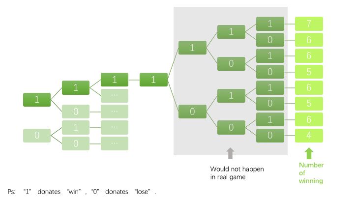

# Introduction

```{r, out.width='100%', fig.align='center', fig.cap='...'}
knitr::include_graphics('ex/braves.png')
```

The **home field advantage** is the edge which a team may have when playing a game at its home stadium. For example, it is the edge the Braves may have over the Yankees when the head-to-head match-up is in Atlanta. It is the advantage the Yankees may have when the head-to-head match-up is in New York.

The World Series is a first-to-4-wins match-up between the champions of the American and National Leagues of Major League Baseball. In this blog, I'm going to introduce simulation and analytic methods to compare the probability of winning the World Series with and without home field advantage.


>Assumptions of My Solution


-   Suppose that the Braves and the Yankees are teams competing in the
    World Series.

-   The table below is the schedule for each game of the
    series. (NYC = New York City, ATL = Atlanta)

| Overall advantage | Game 1 | Game 2 | Game 3 | Game 4 | Game 5 | Game 6 | Game 7 |
|:-----------------:|:------:|:------:|:------:|:------:|:------:|:------:|:------:|
|      Yankees      |   NYC  |   NYC  |   ATL  |   ATL  |   ATL  |   NYC  |   NYC  |

-   Let *P*<sub>*B*</sub> be the probability that the Braves win a
    single head-to-head match-up with the Yankees, under the assumption
    that home field advantage doesn’t exist. Let
    *P*<sub>*B*</sub><sup>*H*</sup> denote the probability that the
    Braves win a single head-to-head match-up with the Yankees as the
    home team (H for home). Let *P*<sub>*B*</sub><sup>*A*</sup> denote
    the probability that the Braves win a single head-to-head match-up
    with the away team (A for away).

| Game location |    No advantage   | Advantage                                                            |
|:-------------:|:-----------------:|:---------------------------------------------------------------------|
|      ATL      | *P*<sub>*B*</sub> | *P*<sub>*B*</sub><sup>*H*</sup> = *P*<sub>*B*</sub> \* 1.1           |
|      NYC      | *P*<sub>*B*</sub> | *P*<sub>*B*</sub><sup>*A*</sup> = 1 − (1 − *P*<sub>*B*</sub>) \* 1.1 |


# Analytical & Simulative Probability
```{r results='hide'}
# Analytical Probability
library(dplyr)

# Get all possible outcomes
apo <- data.table::fread("all-possible-world-series-outcomes.csv")

 
# Home field indicator
hfi<-c(0,0,1,1,1,0,0) #{NYC, NYC, ATL, ATL, ATL, NYC, NYC}

# P_B
pb <- 0.55
advantage_multiplier <- 1.1 # Set = 1 for no advantage


one_calc <- function(apo, pb, advantage_multiplier,hfi) {
  pbh <- pb * advantage_multiplier
  pba <- 1 - (1 - pb) * advantage_multiplier
  # Calculate the probability of each possible outcome
  apo[, p := NA_real_] # Initialize new column in apo to store prob
  for (i in 1:nrow(apo)) {
    prob_game <- rep(1, 7)
    for (j in 1:7) {
      p_win <- ifelse(hfi[j], pbh, pba)
      prob_game[j] <- case_when(apo[i, j, with = FALSE] == "W" ~ p_win
                                , apo[i, j, with = FALSE] == "L" ~ 1 - p_win
                                , TRUE ~ 1)
    }
    apo[i, p := prod(prob_game)] # Data.table syntax
  }
  
  # Sanity check: does sum(p) == 1?
  #apo[, sum(p)] # This is data.table notation
  
  # Probability of overall World Series outcomes
  apo[, sum(p), overall_outcome][[1,2]]  #group by overall_outcome  then sum
}


apwitha<-one_calc(apo, 0.55, 1.1,hfi)
apwithoa<-pbinom(3,7,0.45)

```


Through analytical calculation, we can get the theoretical winning probability.

|P(Braves win with home advantage)|P(Braves win without home advantage)|Absolute difference|
|:-----:|:----------------:|:--------------:|
|0.604221|0.6082878|0.004066825|


Then let's do computer simulation.


## basical way to simulate
we can simply design simulation according to the rule, which is "stop the game when one team won 4 games".
```{r}
onesimu <- function(simulength, pbl) {
  out <- rep(NA, simulength)
  for (i in seq_along(out)) {
    tag <- 0
    for (j in 1:7) {
      tag <- tag + rbinom(1, 1, pbl[j])
      if (tag == 4) {
        break
      }
    }
    out[i] <- tag
  }
  mean(out == 4)
}


pb<-0.55
advantage_multiplier<-1.1
pbh <- pb * advantage_multiplier
pba <- 1 - (1 - pb) * advantage_multiplier
pb1<-c(0.55,0.55,0.55,0.55,0.55,0.55,0.55)
pb2<-c(pba,pba,pbh,pbh,pbh,pba,pba)


p1<-onesimu(10000,pb1)  #without home advantage
p2<-onesimu(10000,pb2)  #with home advantage
#p1-p2
```
This way is easy to understand but not beautiful.

## my way to simulate


Let's take a deep diving into the "first-to-4" rule.
The critical point of the rule is :

<center>*If one team won 4 games, then the game-series are over.*</center>


In statistical words, it means :

<center>*Given that one team already won 4 games,then*  **whatever happens** *in the later doesn't influence the result.*</center>


Assuming that the game will not stop when one team already won 4 games, then there could be various situations, though all of which don't change the result.

```{r, out.width='25%', fig.align='center', fig.cap='...'}

```
Given the example below, the possibility of "Braves win in 4 games" is equal to the overall possibility of 8 events. 


| event| number of winning|
|:-----:|:----------------:|
|1111111|7|
|1111110|6|
|1111101|6|
|1111100|5|
|1111011|6|
|1111010|5|
|1111001|5|
|1111000|4|

Likewise, events "Braves win in 4,5,6,7 games" can also be expanded like above. Obviously, it can be proved that possibility of 

<center>**"Braves win in 'first to 4' competition"**</center>

is equal to the possibility of 

<center>**"Braves win no less than 3 games in 7 games"**</center>

Based on which, I designed my personal way of simulation.


```{r}
#without home advantage
spwithoa<-mean(rbinom(1000000,7,0.55)>3)
### absolut error
withoutabe<-abs(apwithoa-spwithoa)
### relative error
withoutrele<-withoutabe/apwithoa
```

```{r}
#with home advantage
pbh <- pb * advantage_multiplier
pba <- 1 - (1 - pb) * advantage_multiplier
spwitha<-mean((rbinom(1000000,3,pbh)+rbinom(1000000,4,pba))>3)
### absolut error
withabe<-abs(apwitha-spwitha)
### relative error
withrele<-withabe/apwitha
```
***

> Final output is as below.

**Assumptions**

difference=P(braves win with home advantage)-P(braves win without home advantage)

absolute error=|analytical probbility-simulative probability|

relative error=|analytical probbility-simulative probability|/analytical probbility


```{r}
data.frame(approach=c('analytical calculation','simulation'),'P(braves win with home advantage)'=c(apwitha,spwitha),'P(Braves win without home advantage)'=c(apwithoa,spwithoa),'difference'=c((apwitha-apwithoa),(spwitha-spwithoa)))
```


```{r}
data.frame(game_type=c('with home advantage','without home advantage'),'analytical probbility'=c(apwitha,apwithoa),'simulative probability'=c(spwitha,spwithoa),'absolute error'=c(withabe,withoutabe),'relative error'=c(withrele,withoutrele))
```
***


# Bonus Exploration


***
> **Assumptions**

absolute difference=P(braves win with home advantage)-P(braves win without home advantage)

relative difference=(P(braves win with home advantage)-P(braves win without home advantage))/P(braves win without home advantage)

***
## whether difference between possiblity of with and without home advantage  depends on pb?


```{r}
hfi<-c(0,0,1,1,1,0,0)
pb<-seq(1:100)*0.01
diff<-rep(NA,length(pb))
reldiff<-rep(NA,length(pb))
for (i in seq_along(pb)){
  x<-one_calc(apo, pb[i], 1.1,hfi)
  y<-pbinom(3,7,1-pb[i])
  diff[i]<-(x-y)
  reldiff[i]<-diff[i]/y
}

myplot<-function(xp,yp,xname,yname){
plot.new()
plot.window(xlim=range(xp),ylim=range(yp))
lines(xp,yp,type="l",pch=16,col='black',lwd=3)
axis(1)
axis(2)
box()
title(xlab = xname, ylab =yname , line = 2)
}


myplot(pb,diff,'PB','Absolute Difference')
```
```{r}
myplot(pb,reldiff,'PB','Relative difference')

```

We can see that whether difference between possiblity of with and without home advantage  depends on pb.
 

## whether difference between possiblity of with and without home advantage  depends on home-advantage-mutiplier?

```{r}
hfi<-c(0,0,1,1,1,0,0)
pb<-0.55
af<-seq(1:10)*0.05
diff_1<-rep(NA,length(af))
reldiff_1<-rep(NA,length(af))
for (i in seq_along(af)){
  x<-one_calc(apo, pb, af[[i]],hfi)
  y<-pbinom(3,7,1-pb)
  diff_1[i]<-(x-y)
  reldiff_1[i]<-diff[i]/y
}
myplot(af,diff_1,"advanetage factor",'Absolute difference')
```


```{r}
myplot(af,reldiff_1,"advanetage factor",'Relative difference')
```


We can see that whether difference between possiblity of with and without home advantage  depends on home-advantage-mutiplier.


